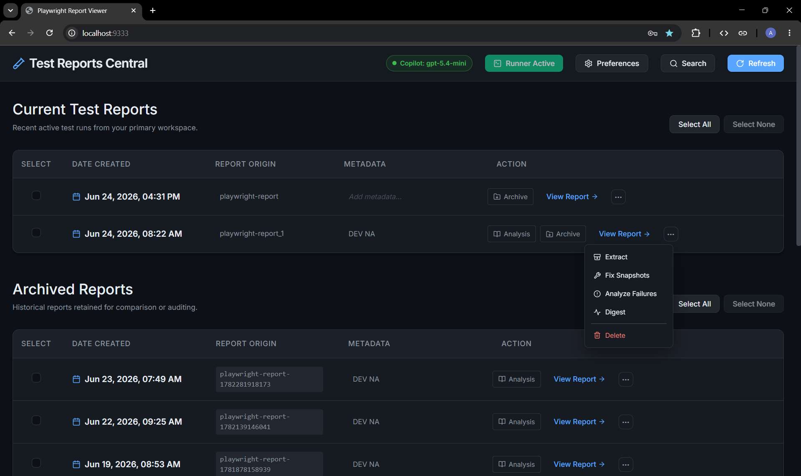

<div align="center">
  
  <h1>Playwright Test Reports Central</h1>
  <p><em>A local dashboard to run, view, archive, and analyze Playwright tests and reports.</em></p>

[](https://nodejs.org/)
[](https://www.typescriptlang.org/)
[](https://expressjs.com/)
[](https://pm2.keymetrics.io/)

<br />

</div>

## What it does

Playwright Test Reports Central brings local Playwright workflows into one dashboard:

- Open, search, label, archive, and delete Playwright HTML reports.
- Run local or BrowserStack tests with saved project presets and live terminal output.
- Analyze failed tests with [`@andrii_kremlovskyi/playwright-traces-reader`](https://www.npmjs.com/package/@andrii_kremlovskyi/playwright-traces-reader) and GitHub Copilot.
- Digest individual traces into structured steps, network data, and console output.
- Review and apply failed aria snapshot updates.
- View and edit Markdown analysis notes associated with reports.
- Expose a local-first API for agents to discover and prepare reports for analysis.

The application runs locally because it needs access to Playwright projects, report directories, SQLite, and the host filesystem.

## Documentation

| Guide                                         | What it covers                                                      |
| --------------------------------------------- | ------------------------------------------------------------------- |
| [Documentation home](docs/index.md)           | Guided entry point and workflow map                                 |
| [Getting started](docs/getting-started.md)    | Installation, startup, PM2, and launch on reboot                    |
| [Configuration](docs/configuration.md)        | Paths, BrowserStack, Copilot, and model selection                   |
| [Running tests](docs/running-tests.md)        | Projects, presets, options, BrowserStack, and live output           |
| [Managing reports](docs/reports.md)           | Search, metadata, bulk actions, archive, delete, traces, and notes  |
| [Failure analysis](docs/failure-analysis.md)  | Analyze failed attempts and inspect generated output                |
| [Trace digestion](docs/trace-digestion.md)    | Parse one test trace into structured data                           |
| [Aria snapshot fixer](docs/aria-snapshots.md) | Review and apply failed accessibility snapshots                     |
| [Agent API](docs/agent-api.md)                | Discover and prepare reports for `playwright-traces-reader`         |
| [Troubleshooting](docs/troubleshooting.md)    | Startup, report discovery, runner, Copilot, and BrowserStack checks |

## Agent Skills

This project owns the `playwright-reports` (discovery and vault access) and
`analyze-playwright-trends` (test history, regression investigation and exact
attempt-to-trace handoff) skills. Trace parsing remains in the reader package's
`analyze-playwright-traces` skill.

From this checkout:

```bash
npm run build
node dist/cli.js init-skills /path/to/test-project
```

Once this package is installed in the target project, use
`npx playwright-reports init-skills`. Both skills are installed into
`.github/skills/`; existing files are skipped unless `--force` is supplied.
Output is JSON by default, with `--format text` available. Installing skills
does not start the hub or modify reports.

Install or refresh the trace skill separately using
`npx playwright-traces-reader init-skills /path/to/test-project`. Older installed
trace skills retain their combined instructions until refreshed. The reader's
existing hub CLI commands remain compatible, but reports-owned skills use this
project's HTTP API directly. See [Agent API](docs/agent-api.md) for the contracts
and read-only verification commands.

## Development

See [ARCHITECTURE.md](ARCHITECTURE.md) before changing report discovery, filesystem synchronization, database identity, or analysis workflows.

```bash
npm run build
npm run restart
npm run logs
```

### Dependency Maintenance

PM2 7.0.4 still pins vulnerable transitive dependencies. Scoped overrides use
`js-yaml` 4.3.2, `basic-ftp` 6.2.3 and `chokidar` 4.0.3 until PM2 updates them.
Chokidar 4 removes the vulnerable glob parser and optional `fsevents` install
script, but no longer supports glob patterns. This project's PM2 configuration
has `watch: false`; if enabling it, use literal file/directory paths and regular
expressions for exclusions. Compatibility tests cover PM2 startup/restart,
directory watching and the dependency APIs used by PM2.

The installed `better-sqlite3` version has an explicit install-script approval
for its native binary/build step. Review and approve a new version explicitly
when upgrading it; do not grant blanket install-script approval. Use `npm audit`
and `npm test` after dependency changes. Avoid `npm audit fix --force`, which can
downgrade PM2 and introduce other vulnerable dependencies.

## Disclaimer

"Playwright" is a trademark of Microsoft Corporation. This independent, community-driven project is not affiliated with, endorsed by, or sponsored by Microsoft or the official Playwright team.

## License

This project is available under the [MIT License](LICENSE).
