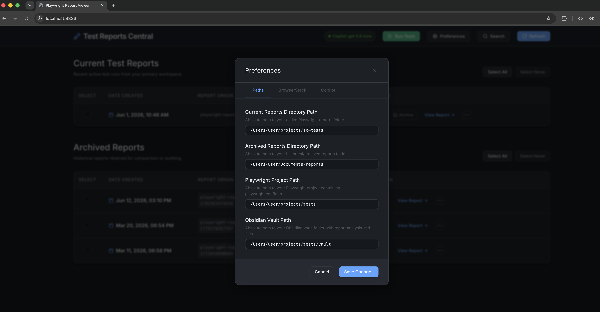

# Configuration

[Back to documentation](index.md) | [Previous: Getting Started](getting-started.md) | [Next: Running Tests](running-tests.md)

After the first launch, open **Preferences** in the top-right corner and configure the dashboard tabs.

 

## Paths

Use absolute paths for each directory.

| Setting                    | Purpose                                                                                                    |
| -------------------------- | ---------------------------------------------------------------------------------------------------------- |
| Current Reports Directory  | Folder where the Playwright project writes new HTML reports, such as `playwright-report`                   |
| Archived Reports Directory | Folder where historical reports should be stored                                                           |
| Playwright Project Path    | Project root recursively scanned for Playwright and BrowserStack config files; required by the test runner |

Final analyses live in their output directories; no Vault Path setting is needed.
After Delete output, the final is retained under
`<currentPath>/analysis/<reportUuid>/<runName>/final-analysis.md`.
An old vault setting is kept internally only to locate legacy notes. Preferences
offers a legacy-review link when it exists; originals are not deleted or moved.

## BrowserStack

Configure these fields when tests will run on BrowserStack:

- **BrowserStack Username**: Your BrowserStack username.
- **BrowserStack Access Key**: Your access key. The UI displays this as a password field.

BrowserStack config files are selected in the test runner, not Preferences.

## Copilot

The optional **GitHub Token** authenticates the shared failure-analyzer package.
It takes precedence over `COPILOT_GITHUB_TOKEN`, `GH_TOKEN`, and `GITHUB_TOKEN`
(in that order), followed by the host's stored Copilot/GitHub CLI login.
Stored-login fallback is disabled when running under CI. The package includes
its SDK runtime; a global Copilot CLI installation is not required.

Select two model roles in the same tab:

| Setting     | Purpose                                                                                  |
| ----------- | ---------------------------------------------------------------------------------------- |
| Small model | Extracts per-issue `evidence.json`; the dashboard renders `ai-analysis.md` from the JSON |
| Big model   | Groups completed issue records into `grouped-analysis.md`                                |

Click either model field to open the shared model picker. Selecting a model saves that field immediately; the two roles are independent and may use the same model. Missing or unavailable selections are not replaced automatically.

## General

The **General** tab follows **Copilot** and contains dashboard behavior settings.

- **Archived report limit**: Maximum number of archived reports to keep. Defaults to **20**; enter a positive whole number.
- When a single or bulk archive operation would exceed the limit, the dashboard asks before deleting older reports to make room.
- Lowering the limit does not immediately delete existing reports. The new limit is checked the next time you archive.

Close any open test runner before changing Preferences. Click **Save changes and reload** after editing the settings. If a runner is open, the dashboard shows a warning and leaves the unsaved form intact. After a successful save, the dashboard reloads and scans the configured directories for valid reports.

Configuration, presets, and report metadata are stored in the local SQLite database `app.db`.

## Check Copilot access

The header's **Copilot** chip reports whether the dashboard can access Copilot.

- On dashboard load, the chip checks authentication and shows `Copilot: ready`, `Copilot: sign in`, or `Copilot: error`.
- Click the chip to run the access check again.
- The chip does not list, select, or replace models. Model selection is available only in **Preferences > Copilot**.
- Analyze Failures validates both selected model IDs before creating an output directory. A missing or stale selection identifies the model role that needs attention.

Continue with [Running Tests](running-tests.md), or go directly to [Managing Reports](reports.md) when reports already exist.
