# Failure Analysis

[Back to documentation](index.md) | [Previous: Managing Reports](reports.md) | [Next: Trace Digestion](trace-digestion.md)

Failure analysis turns the failed attempts in a current report into compact, agent-ready folders, extracts canonical issue evidence for each analyzable failure, and groups those records into run-level problems.

The engine comes from the published
[`@andrii_kremlovskyi/playwright-failure-analyzer`](https://www.npmjs.com/package/@andrii_kremlovskyi/playwright-failure-analyzer)
package (`^0.1.5`, locked to 0.1.5). The dashboard retains report ownership, confirmation,
queued preparation, progress, and final-analysis storage; it does not keep a second
copy of the analysis engine.

## Before you begin

Use the **Copilot** tab in [Preferences](configuration.md#copilot) to configure an optional GitHub token and select the small per-trace model and big grouping model. Authentication follows the [documented precedence](configuration.md#copilot). The header chip checks access only.

Both model stages run without tools or repository instructions. Evidence is not
automatically redacted: test source, errors, page content, and selected network
data may be sent to Copilot. Only analyze reports approved for that service.

## Analyze a report

1. Open the overflow menu on a current report.
2. Click **Analyze Failures**.
3. Keep the dashboard open while the row progress bar is active. Large reports and antivirus scanning can make this operation take time.
4. When analysis finishes, use **Copy Relative Path**, **View index.json**, or **View grouped-analysis.md** in the completion dialog.

Each report retains one analysis output set. When an analysis already exists, **Analyze Failures** opens a warning with **Delete & Analyze** and **Cancel**. Confirming permanently removes the previous output and its saved vault note before generation starts. If the new run fails, the previous analysis cannot be restored. Cancel, Escape, and closing the warning leave existing files unchanged. Invalid configuration or unavailable Copilot access is checked before deletion.

The dashboard calls the package's shared `analyzeFailures` pipeline, including
queued trace preparation, and writes below the Current Reports Directory:

```text
<currentPath>/tmp/analysis-<reportUuid>/run-<UTC timestamp>-<random suffix>/
```

Existing analysis paths remain unchanged until an explicitly confirmed rerun. Manual trace digests are stored separately and are never deleted by analysis replacement.
The replacement confirmation concerns saved report-analysis artifacts, not
Copilot login configuration or the SDK's temporary session storage.

The completion dialog reports trace coverage and warnings for missing or unknown
metadata, excluded/unprocessed attempts, source-only fallbacks, and provisional
grouping. A zero trace count is not proof of a clean report. Partial artifacts
remain inspectable. A failed AI stage or zero successful evidence records with
failed attempts is shown as a red **Failure Analysis Failed** result. Partial
results and warnings are amber; only clean completion is green.
The dashboard and standalone CLI now write the same bundle, including
`analysis-result.json` and a count-only `summary.md`. Controlled preparation
failure also retains a registered diagnostic result for Report Info, even when
no valid manifest exists. HTTP errors and partial completion remain explicit.

## Concurrent requests and trace extraction

Only one failure-analysis request may run for a report at a time. Repeated clicks in the same dashboard page are ignored while that report is active. If another browser tab or client starts the same report concurrently, the server returns `FAILURE_ANALYSIS_IN_PROGRESS`; the row briefly shows **Analysis already running** instead of starting a second CLI process. Different reports can still be analyzed independently, and the bounded three-way Copilot processing inside one completed digest is unaffected.

Preparation explicitly uses four trace-reader workers. Each worker extracts and
prepares one attempt end-to-end before taking another, rather than extracting the
entire report first. Only explicit per-attempt passes are excluded early: failed
retries of eventually passing tests, timeouts, interruptions, and expected
failures remain candidates. Missing metadata retains the reader's fallback;
conflicting or ambiguous attempt metadata produces an error.

Extract and Analyze Failures share a FIFO preparation queue. Only one report's
preparation runs at a time, with up to four workers across these actions.
Waiting rows show **Waiting for preparation slot**. The slot is released when
preparation finishes, before Copilot analysis or grouping, so the next report can
prepare while AI analyzes the previous one. Model selection, prompts, grouping,
and AI concurrency are unchanged. Progress events are scoped to the report UUID.
Manual single-trace Digest and external reader processes are not in this queue.

The trace reader does not extract ZIPs into the report. It uses a persistent, content-addressed cache under the operating system's temporary directory:

```text
<os.tmpdir>/playwright-traces-reader/trace-cache/
```

Concurrent readers publish completed cache entries atomically. The reader accepts a verified competing entry and retries transient Windows `EPERM` rename failures, including brief antivirus or indexing locks. The source report remains unchanged. Before analysis starts, completed entries unused for 24 hours and staging entries older than 1 hour are pruned, unless another live reader lease exists. `PWTR_CACHE_MAX_AGE_HOURS` and `PWTR_CACHE_STAGING_MAX_AGE_HOURS` override those defaults; `0` disables the corresponding age policy. There is no size cap. When no analysis or trace-reader library consumer is running, the entire cache can be deleted and will be rebuilt on demand. See [Troubleshooting](troubleshooting.md#failure-analysis-fails-with-a-trace-cache-eperm-error) for recovery steps.

## Analysis directory layout

Every failed attempt, including each retry, receives a separate folder. A generated run has this general layout:

```text
run-<UTC timestamp>-<random suffix>/
|-- index.json
|-- analysis-result.json
|-- summary.md
|-- grouped-analysis.md
|-- <sanitized-test-title>__retry0/
|   |-- evidence.json
|   |-- ai-analysis.md
|   |-- error.md
|   |-- failure.json
|   |-- dom/
|   |-- screenshots/
|   |-- console-errors.ndjson
|   |-- network-errors.ndjson
|   `-- network-error-bodies.ndjson
`-- <sanitized-test-title>__retry1/
	|-- evidence.json
	|-- ai-analysis.md
	|-- error.md
	|-- failure.json
	|-- dom/
	`-- screenshots/
```

`index.json` is the run manifest. It lists the failed attempts and maps each entry to its output folder. Retry folders are independent records because different attempts of the same test can fail at different steps.

The manifest remains schema v2 and per-attempt evidence remains schema v4.
Result schema v2 records the basename as `runId`, its ISO UTC `createdAt`, source
kind `playwright-reports`, and the report UUID/name. The dashboard does not infer
environment/region from arbitrary report labels; consumers may use consistent
test metadata or request clarification. Creation time is not the test date.

The canonical basename is, for example, `run-2026-11-06T15-04-05-123Z-a1B2c3`.
Neither CI transport wrappers nor the dashboard UUID suffix belong in it.
Existing random-only or timestamp-plus-UUID names are not migrated or renamed.
Older dashboard bundles may lack result metadata; their completion state is
unknown until established from available evidence, not assumed successful.

For downloaded bundles, use the supplied grouped file's local parent manifest.
Absolute paths in headers/JSON are producer-machine provenance, not required
local locations. Keep relative evidence paths intact. A detached grouped report
requires its exact matching local root; do not auto-select a sibling.

Final comparison notes use `final-analysis.md` inside the selected run directory.
They are consumer-owned; do not rewrite analyzer metadata to add them. The team
knowledge base remains optional context, not a storage destination.

### Import a downloaded analysis

1. Download/unzip the HTML report and analysis artifact on the dashboard machine.
   Add the HTML report to Current Reports normally.
2. Open that report's **Info > Import output directory** dialog, paste the absolute
   run directory (or a wrapper with exactly one immediate run child), then **Inspect**.
   `index.json` is required; `grouped-analysis.md` and `final-analysis.md` are
   optional and their presence is shown in the preview.
3. Review provenance, dates, sizes, grouped/final detection and warnings. If trace
   metadata cannot verify the association, explicitly confirm it. Contradictory
   trace/retry identities are rejected, not bypassed by that confirmation.
4. Choose **Import**, or explicitly confirm **Replace analysis**. The server
   copies into `<currentPath>/tmp/analysis-<reportUuid>/<runName>` and registers
   it. The original download is never moved or deleted.

Only current reports accept imports. Canonical and supported legacy bundle names
are retained. An in-bundle legacy `<runName>.md` is normalized to
`final-analysis.md` only in the copy; two competing final files require review.
Unknown legacy analysis dates stay **Unknown**, separate from import time.
Imports make no AI calls, preserve empty directories, verify copied/source hashes,
reject links/traversal, and are bounded to 100,000 filesystem entries, 10 GiB,
128 directory levels and 16 MiB per JSON metadata or root analysis Markdown file. Free disk space is checked
before copying. Identical source bundles already registered are a no-op.
Windows access/sharing errors during import renames receive bounded retries;
persistent failures use the same rollback/recovery flow as other import failures.

Relative evidence links in the final/grouped viewers resolve against their managed
bundle, not the viewer's API URL. Import and viewing do not validate Markdown link
targets, rewrite source Markdown, or fetch external websites to check links.
No evidence-link warning banner is shown. JSON/schema, report-association and
filesystem safety checks still apply; symbolic and hard links are not allowed.

Reopen Info after writing a final externally to refresh its DB reference. Write
into the registered copy if it should appear in the dashboard; editing Downloads
does not update a previously imported copy. Progress appears in the import dialog;
completion appears in Info. Cancel, Escape or the backdrop closes the dialog
before importing; closing is disabled while the import is in progress.
Interrupted replacements retain a transaction journal and backups. Info offers
**Recover interrupted import**: restore the previous analysis if DB registration
did not commit, or finish backup cleanup if it did. Other mutations are blocked
until recovery succeeds; externally changed recovery files require manual review.

The console and network error files are created only when the trace contains that type of evidence. Before Hooks and skipped entries can appear in the manifest, but they are not treated as analyzable test failures and do not receive an AI analysis record.

## End-to-end data flow

```mermaid
flowchart TD
	USER["User clicks Analyze Failures"] --> API["POST /api/failures"]

	API --> ENGINE["Shared analyzer pipeline<br/>canonical identity + result/summary"]
	ENGINE --> QUEUE["Shared preparation queue"]
	QUEUE --> CLI["Trace reader CLI<br/>node cli.js failures REPORT OUTPUT --format json --workers 4"]
	CLI --> RUN["Generated run directory"]
	RUN --> MANIFEST["index.json<br/>attempt manifest"]
	RUN --> FOLDERS["One folder per attempt/retry"]
	FOLDERS --> RAW["Raw extracted evidence<br/>error.md and failure.json<br/>DOM and screenshots<br/>network and console NDJSON"]

	MANIFEST --> FILTER{"Analyzable?<br/>Not skipped or Before Hooks"}
	FILTER -->|No| SKIP["Excluded from model analysis"]
	FILTER -->|Yes| POOL["analyzeRun<br/>3 attempts concurrently"]

	subgraph SMALL_FLOW["Per-attempt evidence flow"]
		POOL --> BLOCKS["errorDetailBlocks<br/>One fenced error block = one issue"]
		BLOCKS --> SMALL["Configured small model<br/>One attempt per session"]
		RAW --> SMALL_INPUT["Model input<br/>full error.md<br/>sanitized failure metadata<br/>optional network errors"]
		SMALL_INPUT --> SMALL

		SMALL --> EXPLANATION["Model returns one explanation per block<br/>summary and operation<br/>expected and observed<br/>supported likely cause<br/>relevant signals<br/>confidence and unknowns"]
		EXPLANATION --> VALIDATE{"Schema, count, and order valid?"}

		VALIDATE -->|No| CORRECT["One correction turn<br/>precise validation error"]
		CORRECT --> VALIDATE2{"Corrected response valid?"}
		VALIDATE2 -->|No| FALLBACK["Low-confidence fallback<br/>Exact source blocks are retained"]
		VALIDATE -->|Yes| ATTACH["Application attaches exact source blocks"]
		VALIDATE2 -->|Yes| ATTACH
		FALLBACK --> EVIDENCE
		ATTACH --> EVIDENCE["evidence.json<br/>Canonical schema v4"]
		EVIDENCE --> MARKDOWN["Deterministic renderer<br/>No model call"]
		MARKDOWN --> AI_MD["ai-analysis.md"]
	end

	POOL -->|Folder processing fails| ERROR_RECORD["Per-attempt error record<br/>Other workers continue"]
	EVIDENCE --> RECORDS["Collect all per-attempt records"]
	ERROR_RECORD --> RECORDS
	RECORDS --> COUNT{"More than one<br/>analyzable attempt?"}
	COUNT -->|No| DONE_SINGLE["Per-attempt analysis complete"]
	COUNT -->|Yes| CATALOG["Build flat issue catalog<br/>I1, I2, I3..."]

	subgraph BIG_FLOW["Run-level grouping flow"]
		CATALOG --> BIG["Configured big model<br/>Tool-free grouping session"]
		BIG_INPUT["Big-model input<br/>test/spec/retry metadata<br/>exact primary error line<br/>small-model explanation"] --> BIG

		BIG --> PROVISIONAL["Complete provisional grouping<br/>summary + problems<br/>every issue ID exactly once<br/>optional evidenceRequests"]
		PROVISIONAL --> REQUEST{"Source evidence requested?"}

		REQUEST -->|Yes| BOUNDED["Application loads selected current-run snippets<br/>error block / final page<br/>test source / network"]
		BOUNDED --> LIMITS["Enforced limits<br/>10 requests maximum<br/>4 issues per request<br/>30 issue references<br/>6,000 chars per section<br/>48,000 chars total<br/>4 MiB per source file"]
		LIMITS --> BIG2["One final evidence turn<br/>No second retrieval round"]
		BIG2 --> FINAL_GROUPS["Final grouping response"]
		REQUEST -->|No| FINAL_GROUPS

		FINAL_GROUPS --> CONTRACT{"Reference contract valid?<br/>all IDs exactly once"}
		CONTRACT -->|No| REPAIR["One repair turn<br/>missing / unknown / duplicate IDs"]
		REPAIR --> RECHECK{"Repair valid?"}
		RECHECK -->|No| SANITIZE["Structural sanitization<br/>remove invalid references<br/>retain unassigned as Unclassified"]
		RECHECK -->|Yes| RENDER
		CONTRACT -->|Yes| RENDER["Application renders report"]
		SANITIZE --> RENDER

		RENDER --> RECONCILE["Reconcile grouped issue count<br/>against extracted issues"]
		RECONCILE --> GROUPED["grouped-analysis.md"]
	end
```



The ownership boundary is intentional: application code owns source preservation, schema checks, path containment, evidence budgets, and rendering. The small model explains each source block, and the big model owns semantic grouping.

| Stage                   | Model receives                                                                                              | Application retains control of                                                                    |
| ----------------------- | ----------------------------------------------------------------------------------------------------------- | ------------------------------------------------------------------------------------------------- |
| Small model             | Full `error.md`, sanitized step metadata, and optional network errors.                                      | Exact source blocks, issue count and order, validation, fallback, and artifact rendering.         |
| Big model               | Manifest context plus each issue's exact primary error line and compact small-model explanation.            | ID/reference validation, evidence limits, path containment, report rendering, and reconciliation. |
| Big-model evidence turn | Only specifically requested, bounded current-run error-block, final-page, test-source, or network sections. | Arbitrary file access or additional retrieval rounds.                                             |

## What `evidence.json` and `ai-analysis.md` contain

After trace extraction, application code parses every fenced block under `# Error details` and writes schema-v4 `evidence.json` beside `error.md`. Each issue contains:

- `blockIndex`, preserving the 1-based source order.
- `source.error`, the first error line, and `source.block`, the exact fenced source block. Both are attached by the application rather than copied from model output.
- `analysis.summary`, nullable `operation`, `expected`, `observed`, and `likelyCause`, arrays of `relevantSignals` and `unknowns`, and `confidence` (`high`, `medium`, or `low`).

The schema intentionally has no application-derived failure family, state key, lifecycle, issue relationship, causal anchor, resolution, or incident key. Supporting metadata can help the small model explain a block, but it cannot create or remove issues.

The dashboard renders `ai-analysis.md` deterministically from the same JSON; there is no Markdown-generation model call. The report shows attempt metadata and every issue's explanation beside its exact source block.

If the first response is not valid JSON, has the wrong issue count or order, or violates the field types, the dashboard makes one focused correction request in the same small-model session. The correction includes the exact validation error and the required schema shape.

`error.md` remains ground truth. `evidence.json` is the canonical model-to-model contract, while `ai-analysis.md` is its human-readable view. `failure.json`, screenshots, and conditional console or network files provide deeper raw evidence when needed.

If the corrected response is still invalid, the dashboard creates one low-confidence fallback issue per source block and keeps each exact block with a warning. A folder is unavailable only when its source files cannot be read or processed. One failed record does not stop analysis of the other failure folders.

## Grouped problem analysis

After every per-attempt record finishes, the dashboard makes an initial Copilot grouping request using the configured big model. The request embeds only:

- The manifest metadata needed for retries, outcomes, and test identity.
- Each issue's exact primary error line and compact small-model explanation from `evidence.json`.

The initial request never sends raw `error.md`, `failure.json`, screenshots, console/network files, previous analyses, vault files, knowledge-base files, or ADO/defect information. The grouping session has no tools enabled.

The grouping projection omits the full source block. Long explanatory fields are bounded to 1,200 characters. Full records remain unchanged in `evidence.json`, and selected source sections remain available through the bounded evidence turn. High-reasoning grouping, evidence, and repair requests each have a 10-minute timeout; diagnostics report the actual prompt size, elapsed time, and configured timeout.

The big model decides which issues represent the same underlying problem by considering their errors, expected and observed behavior, operations, concrete signals, and directly supported causes together. Application code does not force semantic merges or splits. Test titles, retries, manifest steps, broad categories, and generic wording are context rather than proof of identity. Every issue receives a compact ID such as `I1` or `I2` and must be assigned exactly once.

Each grouped problem contains a representative error and one failure explanation. The explanation states the expected and observed behavior and why the assertion or action failed. When the evidence directly supports a cause, the model includes it in that explanation; otherwise it does not speculate or emit a separate unknown root-cause field.

When a plausible merge cannot be decided because critical evidence is missing, ambiguous, or conflicting, a complete provisional response may request one bounded source-evidence round. The application first verifies that the provisional response references every issue exactly once, then accepts only current-run issue IDs and the `error-block`, `final-page`, `test-source`, or `network` sections. It allows at most 10 requests, 4 issue IDs per request, 30 issue references overall, 6,000 characters per section, 48,000 characters of extracted source text overall, and 4 MiB per source file read. Every resolved file must remain inside its assigned failure folder. The selected snippets are sent in a second turn in the same session; no arbitrary file access or second evidence round is allowed. If retrieval or the final response fails, the complete provisional grouping is retained and validated.

After the final response, the dashboard maps issue IDs back to folders and block positions before writing `grouped-analysis.md`, then derives retries, outcomes, test metadata, failure folders, and reconciliation counts from the manifest.

If the response has missing, unknown, or duplicate IDs, the dashboard sends one focused reference-repair turn in the same session. It supplies the previous complete response, the exact allowed ID set, structural diagnostics, and compact evidence for affected valid issues. The corrected response must assign every allowed ID exactly once without changing valid assignments unnecessarily. A failed repair does not discard the initial result: the dashboard removes unknown and duplicate references, drops problems left empty, and retains unassigned valid issues under `Unclassified - invalid grouping references`. This fallback repairs structure only; it does not reinterpret or regroup valid model assignments.

`grouped-analysis.md` contains a summary table, one full section per problem, exact failure-folder pointers, and an extracted-issue reconciliation check. It intentionally contains no previous-run comparison, ADO defects, defect states, products, knowledge-base enrichment, tracked issues, or action-item history. Those remain follow-up work outside the dashboard.

When source-backed evidence cannot be created for a folder, its attempt is retained in an Unclassified problem without reading raw evidence during grouping. If the final grouping request or its validation fails, the digest and all completed evidence files remain available; the completion dialog reports a grouping warning and does not link an invalid grouped report.

Depending on the available trace data, each failure folder can contain:

- `failure.json`
- `error.md`
- Failure-anchored DOM under `dom/`
- Failure screenshots under `screenshots/`
- `network-errors.ndjson` and optional `network-error-bodies.ndjson`
- `console-errors.ndjson`
- `evidence.json`
- `ai-analysis.md`

## Manage analysis

The retained analysis is stored against the report's stable identity and appears under **Analysis** in the report's **Info** dialog. Partial results remain inspectable when AI analysis or grouping fails; the completion dialog reports the warning. Current analyses have these components; archive may retain grouped Markdown separately as described below:

- **Output directory:** The ephemeral run directory containing the manifest, result/summary, conditional grouped analysis, per-attempt folders, and raw evidence. From the Info dialog, you can copy its path, open the manifest or grouped analysis when present, or delete the entire output directory.
- **Analysis file:** Optional `final-analysis.md` inside the run, with explicit DB references after reconciliation/import. Copy, open, edit or delete it independently. Scoped final links remain unambiguous when different reports have the same run name; arbitrary unregistered Markdown files are not listed.

The artifacts follow this lifecycle:

- **Report rename:** The analysis runs remain attached because they are keyed by the report's stable internal identity rather than its folder name. The server updates the separate filesystem identity timestamp after the move; the original dashboard creation date and date filters stay unchanged.
- **Delete output directory:** First preserve/register the final at `<currentPath>/analysis/<reportUuid>/<runName>/final-analysis.md`, then remove the raw output including grouped analysis. Preservation failure prevents deletion.
- **Delete analysis file:** The mapped final Markdown file is removed. The generated output directory and any preserved archived grouped file remain available. The run entry is removed only when no output or grouped artifact remains.
- **Archive report:** Preserve `<archivePath>/analysis/<reportUuid>/<runName>/final-analysis.md` when present, otherwise `grouped-analysis.md` in that directory. The full raw bundle is not archived. Preservation must succeed before the report move/cleanup; failures retain the source and restore references. Grouped fallback remains distinct from final notes.
- **Delete report:** Remove its managed outputs, retained/archive files and DB records, never the original Downloads bundle or original legacy vault/sibling notes.
- **Report removed or replaced outside the dashboard:** The next directory scan removes run records belonging to the missing report instance and prevents them from being attached to a new report that reuses the same folder name.

Deleting an output directory does not change the Playwright report folder itself; analysis output lives under the Current Reports Directory's separate `tmp` folder.

### Existing reports and duplicate history

Schema upgrade preserves records and adds explicit artifact references. Reopening Info reconciles an unambiguous current legacy final by copying it into managed canonical storage, leaving its original untouched. Existing flat archive files remain readable without bulk moves. Missing, conflicting or shared artifacts require review. Deleting a migrated canonical final does not rediscover its preserved legacy original. Unregistered old vault notes remain visible through `GET /api/analysis/legacy`.

When older reports contain multiple outputs or competing saved analysis notes, **Info** displays **Review analysis data**. The confirmation lists the exact paths to keep and delete and requires an explicit keeper selection. Only confirmed surplus artifacts are removed. The only remaining output or saved note cannot be selected for duplicate removal. Cancel preserves every artifact and mapping.

Ambiguous ownership, complementary records, unsafe paths, and conflicting file locations block automatic consolidation. Those records remain accessible for manual review; they are not silently discarded or hidden. A new analysis is blocked until the review is resolved. Cleanup confirmation and **Delete & Analyze** are separate actions.

The server also enforces confirmation for direct API requests and rejects stale approvals. Archive, rename, storage-path changes, and artifact deletion cannot interfere with active jobs. A vault editor opened before a note was changed or deleted must reload before saving.

### Development verification

Run `npm test` from this project. Artifact tests use disposable SQLite databases and synthetic report files below `tests/`; they do not use configured report directories or another project's test suite. `PLAYWRIGHT_REPORTS_DB_PATH` overrides the database location for an isolated test server.

Focused check: `npm run build && node --test tests/report-artifacts.test.js`. The tests include preservation, explicit consent, duplicate review, interrupted digest relocation, concurrent requests, the installed trace-reader CLI, and archive behavior. Browser checks are in `tests/artifact-browser.js`, run through `playwright-cli run-code --filename=tests/artifact-browser.js` against `tests/artifact-test-server.cjs` with `ARTIFACT_TEST_SEED=browser`, a disposable `ARTIFACT_TEST_ROOT`, and `PLAYWRIGHT_REPORTS_DB_PATH` set inside that root. Never point the synthetic server at a real report database.

For one test rather than every failure in a report, use [Selective Trace Digestion](trace-digestion.md).
